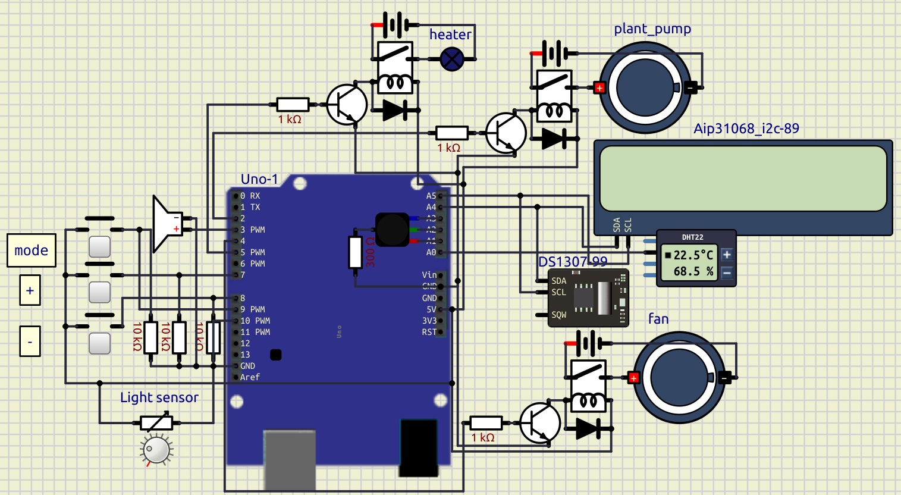

# Automated Greenhouse Controller

An Arduino-based automated microclimate controller designed for a small greenhouse. The system monitors temperature, humidity, and light levels, and automatically controls watering, ventilation, heating, and lighting. It also features dynamic RGB LED visual animations for different operational states.

## 📖 Table of Contents
- [Introduction](#introduction)
- [Hardware Components](#hardware-components)
- [Wiring Diagram](#wiring-diagram)
- [Software Implementation](#software-implementation)
- [Testing and Results](#testing-and-results)
- [Economic Evaluation](#economic-evaluation)
- [Safety Rules](#safety-rules)
- [Future Enhancements](#future-enhancements)

---

## Introduction

Modern crop production increasingly relies on automation. Maintaining optimal temperature, humidity, and lighting while ensuring timely watering is crucial. Doing this manually can lead to delayed watering or unnoticed overheating.

**Project Goal:** To develop and assemble an automated greenhouse microclimate controller to monitor conditions and water plants automatically.

**Key Tasks:**
- Study the physical principles of temperature, humidity, and light sensors.
- Select components and assemble the circuit.
- Write firmware for the Arduino platform.
- Conduct testing.
- Calculate the cost and compare it with commercial analogues.

**Novelty:** The system is built on an affordable Arduino platform, utilizing a DHT22 sensor, a DS1307 real-time clock, an LCD display, and controlling a pump, fan, heater, and lighting. The project features a unique RGB status indication system with smooth animations (water flow effect for watering, fire flicker effect for heating).

---

## Hardware Components

| No. | Component | Qty | Notes |
|---|-----------|--------|-------|
| 1 | Arduino Uno or Nano | 1 pc. | Microcontroller |
| 2 | DHT22 Sensor | 1 pc. | Temperature and humidity |
| 3 | RTC DS1307 Module | 1 pc. | Real-time clock |
| 4 | LCD Display 16×2 with I2C | 1 pc. | Information output |
| 5 | Tactile Buttons | 3 pcs. | Menu control |
| 6 | Relay Module | 4 pcs. | For pump, fan, heater, light |
| 7 | Water Pump | 1 pc. | Watering |
| 8 | Fan (5–12 V) | 1 pc. | Cooling |
| 9 | Heating Element | 1 pc. | Heating |
| 10 | LED Panel | 1 pc. | Lighting |
| 11 | Photoresistor | 1 pc. | Light sensor |
| 12 | RGB LED | 1 pc. | Visual indication |
| 13 | Piezoelectric Buzzer | 1 pc. | Sound signal |
| 14 | Wires & Breadboard | — | Assembly |
| 15 | Power Supply (5 V, 2 A) | 1 pc. | Power |

---

## Wiring Diagram

> **Note:** The image below must be placed in the root directory of the repository or inside the `schemes/` folder.

### Pin Configuration

| Device | Arduino Pin | Note |
|---|---|---|
| DHT22 | A0 | Temp/Humidity Sensor |
| RTC DS1307 / LCD I2C | A4 (SDA), A5 (SCL) | I2C bus, LCD address `0x3E` |
| Button "+" | 7 | Menu control |
| Button "−" | 8 | Menu control |
| Button "Mode" | 9 | Menu control |
| Heater | 5 | Via relay |
| Fan | 4 | Via relay |
| Pump | 6 | Via relay |
| LED Panel | 12 | Via relay |
| Light Sensor | 10 | Analog input |
| RGB: Red | A1 | Visual indication |
| RGB: Green | A2 | Visual indication |
| RGB: Blue | A3 | Visual indication |
| Buzzer | 3 | Sound signal |

---

## Software Implementation

The firmware is written in C++ and can be compiled using **Platform IO** or the **Arduino IDE**.

### Project Structure
- `main.ino` — Main logic: `setup()`, `loop()`, button handling, relay control, and LCD output.
- `config.h` — Pin definitions, polling periods, temperature thresholds, and watering schedule.
- `symbols.h` — Custom LCD characters (degree symbol, fan icon).

### Key Functions
- `debounce()` — Handles button debouncing.
- `buzz_pic()` — Generates a sound signal.
- `update_Max_Min_temperature()` / `update_Max_Min_humidity()` — Tracks max/min values.
- `printTwoDigits()` — Outputs numbers with a leading zero.
- `RGB_watering()` — Controls the blue water animation during pump operation.
- `RGB_heatering()` — Controls the fire flicker animation during heating.

### Algorithm Logic
1. On startup, sensors, LCD, and RTC are initialized. If the RTC is not running, it is set to the compilation time.
2. In the main loop:
   - The current time is read from the RTC.
   - Air temperature and humidity are measured.
   - Light levels are checked.
   - If temperature is below the minimum — heater and fan turn on.
   - If temperature is above the maximum — only the fan turns on.
   - If light is insufficient — the LED panel turns on.
   - At a scheduled time (e.g., 14:00) — the pump turns on for 5 seconds.
   - **RGB Indication:** 
     - When the pump is active, the RGB LED smoothly transitions through shades of blue.
     - When the heater is active, the RGB LED flickers with fire-like colors (red, orange, brown).
   - The LCD displays time, temperature, and humidity.
   - Buttons switch display modes.

---

## Testing and Results

| Parameter | Value |
|---|---|
| Supply Voltage | 5 V |
| Temperature Range | 18–25 °C |
| Humidity Range | 40–70 % |
| Watering Time | 14:00 |
| Watering Duration | 5 s |
| Button Response | Working |
| LCD Output | Working |
| Sound Signal | Working |
| RGB Animations | Working |

**Notes:**
- The DHT22 sensor has a delay of about 2 seconds during sharp temperature changes due to sensor inertia. This is acceptable for greenhouse conditions.
- The system successfully activates the fan during overheating and turns on the light when illumination is insufficient.
- The RGB LED provides clear, intuitive visual feedback of the system's current state.

---

## Economic Evaluation

| No. | Component | Cost, USD |
|---|---|---|
| 1 | Arduino Uno | $5.00 |
| 2 | DHT22 | $2.50 |
| 3 | RTC DS1307 | $1.50 |
| 4 | LCD 16×2 I2C | $2.50 |
| 5 | Relay module (4 pcs.) | $4.00 |
| 6 | Pump | $2.00 |
| 7 | Fan | $1.50 |
| 8 | Heater | $1.00 |
| 9 | LED panel | $2.00 |
| 10 | Wires, breadboard | $2.00 |
| 11 | Case | $2.00 |
| 12 | Power supply | $3.00 |
| **Total** | | **$29.00** |

The cost of the product is 2–10 times lower than commercial analogues with comparable capabilities. The system is fully repairable: any part can be replaced separately.

### Comparison with Commercial Analogs

| Model | Price, USD | Features |
|---|---|---|
| Ready-made "smart pot" | $50 – $150 | Watering, light |
| Auto-watering system | $30 – $80 | Watering only |
| Industrial greenhouse controller | $100 – $300 | Full control |
| **Our controller** | **~$29.00** | Watering, temperature, humidity, light, RGB indication |

---

## Safety Rules

- Do not allow water to get on electronics and wires.
- Use only working power supplies and wires.
- Connect the pump, fan, and heater only through relays.
- Observe polarity when connecting power.
- Do not leave the system unattended during initial testing.
- Follow fire safety rules when working with a soldering iron.
- Hand in used batteries to collection points.

---

## Future Enhancements

1. **Light Sensor Calibration:** The `MIN_light_val` is currently approximate. It should be calibrated based on real-world indoor lighting conditions.
2. **"−" Button Implementation:** The "−" button is currently read but not assigned to a specific action. Implementing it would allow reverse navigation through the menu.
3. **Settings Menu:** Modes 4 and 5 are reserved in the code for future manual control or threshold adjustments.
4. **Hardware Protection:** For long-term use, adding 10kΩ pull-up resistors to the button pins is recommended.
5. **Hardware PWM Note:** Pins A1, A2, A3 on Arduino Uno do not support PWM. For smooth RGB color transitions in a real physical build, these should be moved to PWM-capable pins (e.g., 3, 5, 6, 9, 10, 11).
